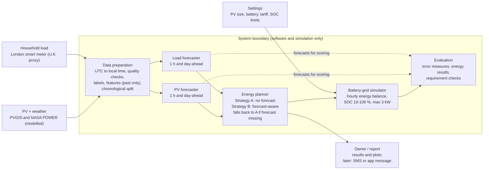

# Solar Forecast – Weather-Aware PV and Household Load Forecasting for Rooftop-Solar Energy Planning (Sri Lanka)

EE4301 Research and Design Project · Faculty of Engineering, University of Sri Jayewardenepura
Author: Menuka Jeewantha

This repository is a **software and simulation-only** system. It forecasts rooftop solar PV
generation and household electricity load, uses the forecasts in an energy planner, and tests
the plans in an hourly battery–grid simulator. No hardware is built.

---

## System architecture

The system has **three external inputs**, **six internal blocks** inside one system boundary,
and **one external output**. Data flow is strictly left to right, except the simulator, which
sends its results back to the evaluation block.

### External inputs (outside the system boundary)

| Input | Folder | Description |
|---|---|---|
| **PV + weather data** | `data/raw/pv_weather/` | Hourly PVGIS PV power (1 kWp, modelled) and NASA POWER / PVGIS weather, UTC, 2021–2023 |
| **Household load data** | `data/raw/load/` | London smart-meter data (UK Power Networks), used as a labelled U.K. proxy |
| **Settings** | `config/settings.yaml` | PV size (3 kWp), battery (5 kWh, 3 kW, SOC 10–100 %, 90 % round trip), tariff |

### Internal blocks (inside the system boundary)

| # | Block | Folder | Job |
|---|---|---|---|
| 1 | **Data preparation** | `src/data_preparation/` | UTC → local time (UTC+5:30), quality checks, dataset labels, past-only features, chronological split (2021 train / 2022 validation / 2023 test) |
| 2 | **PV forecaster** | `src/pv_forecaster/` | 1-hour-ahead and day-ahead PV forecasts (Random Forest, XGBoost, MLP, LSTM; baselines: persistence, same hour yesterday) |
| 3 | **Load forecaster** | `src/load_forecaster/` | 1-hour-ahead and day-ahead household load forecasts (same model families) |
| 4 | **Energy planner** | `src/energy_planner/` | Strategy A: no forecast. Strategy B: forecast-aware rules. Falls back to Strategy A if a forecast is missing or invalid |
| 5 | **Battery–grid simulator** | `src/simulator/` | Hourly energy balance (PV + grid + discharge = load + charge + curtailment), SOC limits 10–100 %, max 3 kW |
| 6 | **Evaluation** | `src/evaluation/` | Error measures (MAE, RMSE, nRMSE, bias, skill), energy results, requirement checks |

### External output

| Output | Folder | Description |
|---|---|---|
| **Owner / report** | `results/` | Results tables, plots, requirement status; later an SMS or app message |

### Connections (draw exactly these arrows)

Solid arrows = data / energy flow. Dashed arrow = forecasts sent for scoring.

1. PV + weather data → Data preparation
2. Household load data → Data preparation
3. Data preparation → PV forecaster
4. Data preparation → Load forecaster
5. PV forecaster → Energy planner
6. Load forecaster → Energy planner
7. Energy planner → Battery–grid simulator
8. Settings → Battery–grid simulator
9. Battery–grid simulator → Evaluation
10. PV forecaster and Load forecaster ⇢ Evaluation (dashed: forecasts sent for scoring)
11. Energy planner → Owner / report

### Reference diagram (Mermaid)



---

## Repository structure

```
solar-load-forecast/
├── README.md
├── config/
│   └── settings.yaml              # PV size, battery, tariff, SOC limits (Settings input)
├── data/
│   ├── raw/
│   │   ├── pv_weather/            # merged_nasa_pvgis_hourly.csv (PV + weather input)
│   │   └── load/                  # London smart-meter files (household load input)
│   └── processed/                 # outputs of data preparation
├── src/
│   ├── data_preparation/          # Block 1
│   │   ├── load_and_clean.py
│   │   ├── features.py
│   │   └── split.py
│   ├── pv_forecaster/             # Block 2
│   │   ├── baselines.py
│   │   ├── tree_models.py         # Random Forest, XGBoost
│   │   └── neural_models.py       # MLP, LSTM
│   ├── load_forecaster/           # Block 3
│   │   ├── baselines.py
│   │   ├── tree_models.py
│   │   └── neural_models.py
│   ├── energy_planner/            # Block 4
│   │   ├── strategy_a_no_forecast.py
│   │   ├── strategy_b_forecast_aware.py
│   │   └── fallback.py
│   ├── simulator/                 # Block 5
│   │   └── battery_grid_sim.py
│   └── evaluation/                # Block 6
│       ├── metrics.py
│       ├── energy_results.py
│       └── requirement_checks.py
├── notebooks/
│   ├── 01_data_cleaning.ipynb
│   ├── 02_pv_forecasting.ipynb
│   ├── 03_load_forecasting.ipynb
│   └── 04_energy_simulation.ipynb
└── results/                       # Owner / report output
    ├── figures/
    └── tables/
```

---

## Notes for diagram tools (e.g. GitDiagram)

- Group blocks 1–6 inside one box labelled **“System boundary (software and simulation only)”**.
- Place **PV + weather**, **Household load** and **Settings** on the left, outside the boundary.
- Place **Owner / report** on the right, outside the boundary.
- Put **Data preparation**, the two **forecasters** and the **Energy planner** in the top row;
  put **Evaluation** and the **Battery–grid simulator** in the bottom row.
- Use solid arrows for data/energy flow and a dashed arrow from the forecasters to Evaluation.
- Do not add a database, web server, API or cloud service: the system runs as Python scripts and
  notebooks on one computer.

## Data labels

- PV power is **PVGIS-modelled**, not measured on a real roof.
- Household load is a **U.K. proxy** (London), not Sri Lankan data.
- All results are **simulation results** for a constructed design case (3 kWp PV, 5 kWh battery).
